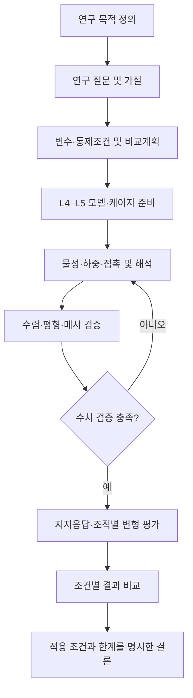

# 연구 전체 프로세스 블록도

- **편집 원본:** [diagrams/research-overall.drawio](../diagrams/research-overall.drawio)
- 아래 Mermaid 그림은 GitHub 문서에서 흐름을 빠르게 확인하기 위한 **요약 도식**이다. 세부 내용·수정은 draw.io 원본을 기준으로 한다.

**범위 주의:** 기존 원본의 종판·해면골 2요인×2수준 및 특정 물성 수치는 현 시점에서 최종 확정값으로 취급하지 않는다.
