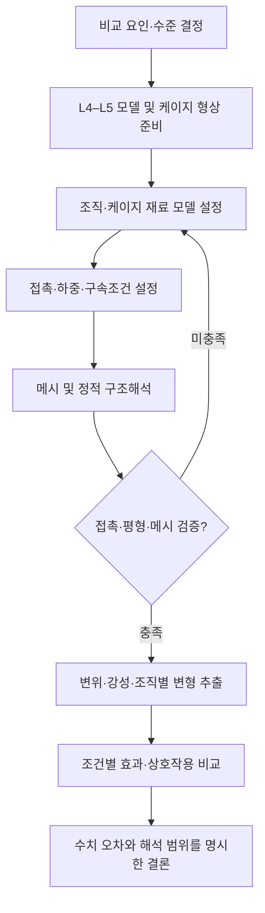

# 유한요소해석 프로세스 블록도

- **편집 원본:** [diagrams/analysis-process.drawio](../diagrams/analysis-process.drawio)
- 아래 Mermaid는 상세 도식의 핵심 절차를 줄여 표현한다.

## 기존 원본과의 연결

원본에는 2요인×2수준의 네 물성 조합, 400 N 축압축, 수렴 검증, 지지변위·강성·조직별 변형률 및 상호작용 계산까지 상세히 기록돼 있다. 이들은 **기존 기록된 설계안**이며, 현재 최종 적용 조건이 모두 검증된 것은 아니다.
